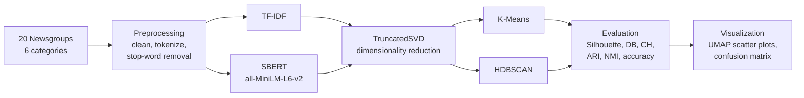

# Document Clustering for Topic Modeling

**A controlled comparison of TF-IDF vs. SBERT document representations, clustered with K-Means and HDBSCAN, on the 20 Newsgroups dataset.**

Data Science Micro Project · 25AI211 – Machine Learning Fundamentals · Division of AIML, Karunya Institute of Technology and Sciences · October 2026

---

## Overview

Large document collections grow far faster than anyone can organize them by hand. Document clustering groups unlabeled text by similarity, so topics emerge from the data instead of being defined in advance.

Clustering quality depends on two separate choices:

1. **Representation:** how text is turned into numbers
2. **Algorithm:** how those numbers are grouped

Most existing studies vary only one of these. This project varies **both** in a controlled **2 × 2 design**, with identical data, preprocessing and evaluation for every combination:

|            | K-Means (partition-based) | HDBSCAN (density-based) |
|------------|---------------------------|-------------------------|
| **TF-IDF** (lexical)  | ✔ | ✔ |
| **SBERT** (semantic)  | ✔ | ✔ |

## Key result

**SBERT + K-Means** is the clear winner. It finds **exactly 6 clusters for the 6 true categories**, leaves no documents unclustered, and reaches **ARI 0.710**, **NMI 0.728** and **87.3% majority-vote accuracy**, all without seeing a single label during clustering.

The study also shows that representation and algorithm **interact**: switching from TF-IDF to SBERT nearly doubles K-Means' ARI (0.373 → 0.710) but does nothing for HDBSCAN, which labels more than half of the documents as noise with either representation.

---

## Dataset

[20 Newsgroups](http://qwone.com/~jason/20Newsgroups/), loaded with `sklearn.datasets.fetch_20newsgroups`, restricted to 6 categories (**5,509 documents**):

`comp.graphics` · `rec.autos` · `rec.sport.hockey` · `sci.med` · `sci.space` · `talk.politics.mideast`

Ground-truth labels are held out during clustering and are used **only** for evaluation.

## Pipeline



| Step | What happens | Tools |
|------|--------------|-------|
| 1. Data ingestion | Load the 6-category subset into a DataFrame; hold labels out | scikit-learn, pandas |
| 2. Preprocessing | One `clean_text()` function, applied identically before both representations | `re`, NLTK |
| 3. Feature extraction | TF-IDF matrix and SBERT embeddings from the same cleaned text; TruncatedSVD before clustering; UMAP to 2-D for plots only | scikit-learn, sentence-transformers, umap-learn |
| 4. Clustering | K-Means and HDBSCAN on both representations; hyperparameters chosen by sweep | scikit-learn, hdbscan |
| 5. Evaluation | 3 internal + 2 external metrics; majority-vote accuracy and confusion matrix for the best combination | scikit-learn |
| 6. Visualization | Interactive UMAP scatter plots, confusion-matrix heatmap, top TF-IDF keywords per cluster | Plotly, Seaborn |

---

## Results

| Representation | Algorithm | Clusters | Noise % | Silhouette ↑ | Davies-Bouldin ↓ | Calinski-Harabasz ↑ | ARI ↑ | NMI ↑ |
|---|---|---|---|---|---|---|---|---|
| TF-IDF | K-Means | 11 | 0.0 | 0.063 | 3.820 | 102.5 | 0.373 | 0.558 |
| TF-IDF | HDBSCAN | 4 | 64.6 | 0.089 | 2.404 | 72.5 | 0.046 | 0.170 |
| **SBERT** | **K-Means** | **6** | **0.0** | **0.089** | 3.359 | **257.8** | **0.710** | **0.728** |
| SBERT | HDBSCAN | 2 | 55.2 | 0.015 | 2.022 | 7.1 | 0.038 | 0.050 |

> The HDBSCAN rows have lower (better-looking) Davies-Bouldin scores because internal metrics are computed only on the points that were not labelled noise, which is less than half of the data. The external metrics (ARI, NMI) show that those clusters do not match the true topics.

### Cluster visualizations (UMAP 2-D projection)

| TF-IDF + K-Means | TF-IDF + HDBSCAN |
|---|---|
|  |  |
| 11 overlapping clusters, over-partitioned | 64.6% of documents marked as noise |

| SBERT + K-Means ⭐ | SBERT + HDBSCAN |
|---|---|
|  |  |
| 6 compact, well-separated clusters | 2 clusters, 55.2% noise |

### Confusion matrix: SBERT + K-Means (accuracy 87.3%)


| Category | Correct / Total | Recall |
|---|---|---|
| comp.graphics | 752 / 918 | 82% |
| rec.autos | 766 / 892 | 86% |
| rec.sport.hockey | 869 / 943 | 92% |
| sci.med | 799 / 940 | 85% |
| sci.space | 842 / 935 | 90% |
| talk.politics.mideast | 783 / 881 | 89% |
| **Overall** | **4,811 / 5,509** | **87.3%** |

Most errors flow into the `sci.space` cluster, which absorbs general technical posts that share vocabulary with several categories. The largest single confusion is `comp.graphics → sci.space` (148 documents).

---

## Conclusions

- **Semantic beats lexical.** With K-Means, SBERT nearly doubles ARI over TF-IDF (0.710 vs 0.373).
- **Partition beats density on this data.** HDBSCAN discards 55–65% of documents as noise with both representations, because the reduced feature space lacks the sharp density gaps it relies on.
- **The cluster count validates the method.** SBERT + K-Means recovers exactly the 6 true categories with zero unclustered documents.
- **Representation and algorithm must be chosen together.** A better representation only helps when the algorithm's assumptions fit the data.

---

## How to run

```bash
git clone https://github.com/davidmammen-dev/document-clustering-topic-modeling.git
cd document-clustering-topic-modeling
pip install -r requirements.txt
jupyter notebook document_clustering.ipynb
```

The 20 Newsgroups dataset and the SBERT model are downloaded automatically on first run.

## Tech stack

Python · pandas · NumPy · scikit-learn · NLTK · sentence-transformers · hdbscan · umap-learn · Plotly · Seaborn

## Team

| Name | Register No. |
|---|---|
| David Mammen | URK25CS7021 |
| Harshak S | URK25CS7028 |
| Joran Scader J | URK25CS7158 |
| M Sanjeev | URK25CS7160 |

**Guide:** Mrs. Sindhu, Assistant Professor, Division of AIML, Karunya Institute of Technology and Sciences

## References

1. F. Pedregosa et al., "Scikit-learn: Machine Learning in Python," *JMLR*, 2011.
2. N. Reimers and I. Gurevych, "Sentence-BERT: Sentence Embeddings using Siamese BERT-Networks," *EMNLP*, 2019.
3. L. McInnes, J. Healy and J. Melville, "UMAP: Uniform Manifold Approximation and Projection," 2018.
4. L. McInnes, J. Healy and S. Astels, "hdbscan: Hierarchical Density Based Clustering," *JOSS*, 2017.
5. K. Lang, "NewsWeeder: Learning to Filter Netnews," *ICML*, 1995.
6. M. Cherradi and A. El Haddadi, "Exploration of Scientific Documents through Unsupervised Learning-Based Segmentation," *IJACSA*, 2024 (base paper).
